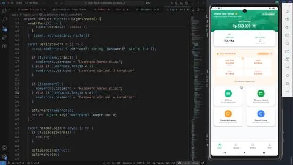
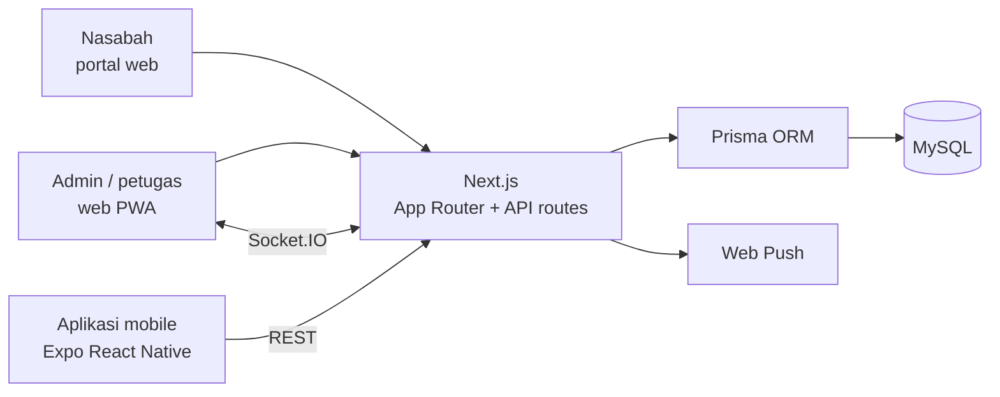
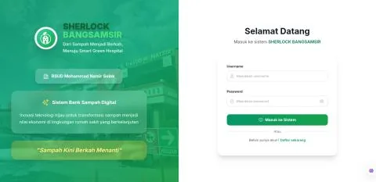
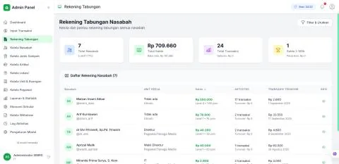

# Sherlock BANGSAMSIR — Bank Sampah & Koperasi Ekonomi Sirkular

> Platform pengelolaan sampah berbasis ekonomi sirkular dan koperasi yang menghubungkan RSUD M. Natsir Solok dengan sekolah dan instansi pemerintah. Nasabah menyetor sampah, mengumpulkan saldo tabungan, menukar poin, dan mencairkan hasil penjualan sampah menjadi uang. Tersedia sebagai web admin, portal nasabah, dan aplikasi mobile.

| | |
|---|---|
| Instansi | RSUD Mohammad Natsir Solok |
| Peran saya | Developer tunggal: riset kebutuhan, UI/UX, backend, web, mobile, deployment |
| Platform | Web admin + portal nasabah (PWA), aplikasi Android (Expo), dipublikasikan di Play Store |
| Status | Produksi, aktif dikembangkan |

## Masalah yang diselesaikan

Program bank sampah rumah sakit sebelumnya dicatat manual: setoran per jenis sampah, saldo nasabah, dan penarikan sulit dilacak dan direkap. Sherlock BANGSAMSIR mencatat seluruh siklus, dari setoran sampai pencairan, dan membuka program ini untuk sekolah dan instansi lain sebagai nasabah.

## Fitur utama

- **Nasabah dan rekening tabungan**: pendaftaran nasabah (pegawai, sekolah, instansi), kategori pengguna, rekening dan saldo.
- **Transaksi setoran** per jenis sampah dengan harga per jenis, riwayat transaksi, dan laporan.
- **Penarikan saldo** (withdrawal) dengan alur persetujuan.
- **Poin dan penukaran**: transaksi poin, katalog item penukaran, tukar poin.
- **Ekonomi sirkular**: pencatatan hasil olahan dan penjualan sampah.
- **Konten edukasi**: artikel untuk nasabah.
- **Master data**: jenis sampah, lokasi, unit/ruangan, pegawai, modul aplikasi.
- **Operasional**: log aktivitas, notifikasi push, pembaruan data real-time melalui Socket.IO, ekspor laporan PDF/Excel.

## Arsitektur

Monorepo `apps/web` (Next.js) dan `apps/mobile` (Expo Router), di-deploy dengan Docker.

## Model data (ringkas)

`User` · `KategoriUser` · `BankAccount` (rekening/saldo) · transaksi setoran · penarikan · transaksi poin · item penukaran · `EkonomiSirkular` · jenis sampah · artikel · lokasi · unit kerja

## Tech stack

| Lapis | Teknologi |
|---|---|
| Web | Next.js, React, TypeScript, Tailwind CSS, PWA (Workbox) |
| Mobile | Expo React Native, Expo Router |
| Data | MySQL via Prisma ORM |
| Real-time | Socket.IO, Web Push |
| Lain-lain | Zod, React Hook Form, SWR, jsPDF, SheetJS |
| Deploy | Docker |

## Galeri

| | |
|---|---|
|  |  |

Lihat juga: [bangsamsir-docs](https://github.com/izanmaizan/bangsamsir-docs) (versi web awal), [sherlock-bangsamsir-mobile](https://github.com/izanmaizan/sherlock-bangsamsir-mobile).

---

> **Catatan kerahasiaan.** Kode sumber aplikasi ini private karena milik/dipakai instansi. Repo ini hanya menjelaskan konteks, fitur, arsitektur, dan peran saya. Tidak ada kode, data pegawai, data pasien, alamat server, maupun kredensial di sini.

**Maizan Insani Akbar** · Software Engineer & System Analyst · [Portfolio](https://izanmaizan.vercel.app) · [LinkedIn](https://www.linkedin.com/in/izanmaizan/) · [GitHub](https://github.com/izanmaizan)
